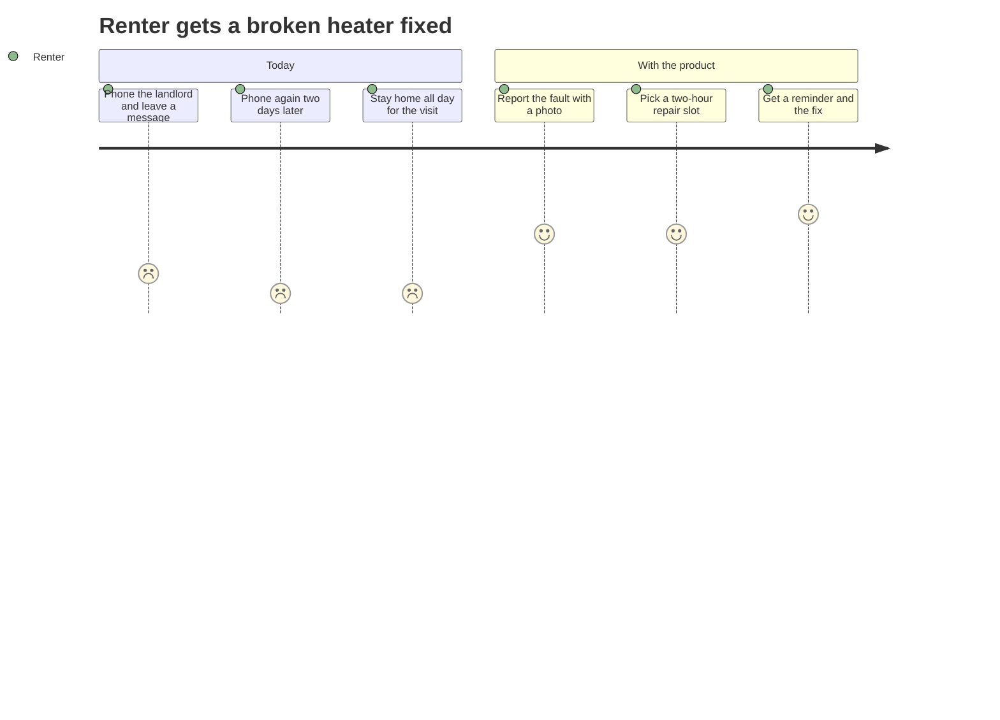
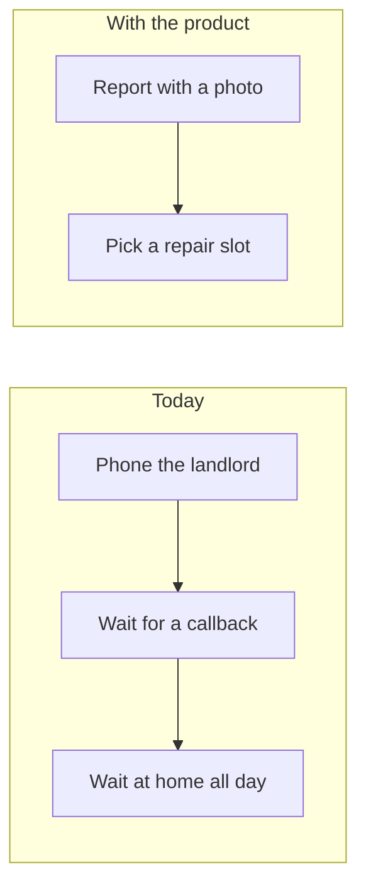

# Format: PR/FAQ (Working Backwards)

A PR/FAQ is the press release (PR) a team would publish on the day a product launches, written before anyone builds it, followed by the frequently asked questions (FAQ) that press release raises and a few visuals of the customer experience. Amazon calls the practice *working backwards*: start from the customer's problem and the experience that solves it, then decide whether the product is worth building.

The document does two jobs at two moments. Before the build decision, it tests the idea: if the press release is hard to write convincingly, the product probably is not worth building, and most PR/FAQs are never approved. That is the process working, not failing. After approval, the press release becomes the reference the team checks its work against, and the FAQ tells the builders why a customer would use the product and what they get from it.

A PR/FAQ is a tool for getting clarity, not a write-up of a decision already taken. If the team has already committed and wants to record what it is building, this is the wrong format.

## When to use vs. adjacent formats

- **PR/FAQ** (this format): the product or feature does not exist yet, and you want to find out whether it should, by describing it from the customer's side first.
- **Proposal** (`proposal/`): the options are known and you want a decision between them. A proposal argues for a choice; a PR/FAQ describes an outcome and lets the reader judge it.
- **Poster** (`poster.md`): the work already exists and needs a durable front page. An approved PR/FAQ is often linked from the poster as the founding document.
- **RFC (request for comments) or design doc**: how to build it. The PR/FAQ stays at the level of what the customer experiences; the Internal FAQ may name hard technical problems but does not solve them.
- **Launch announcement or blog post**: the product has shipped and you are telling people. That is a real press release, written in the past tense about real numbers. Do not use this format for it.

Disambiguating question: **is the product not yet built, and are you writing to find out whether it should be?** If yes, PR/FAQ.

### On the name

This format also answers to *PRFAQ*, *working backwards doc*, and *future press release*. They are the same artifact. The press release is always written as if it is launch day; no source treats "future" and "launch" press releases as different types.

### Who the customer is

The customer is the **end user of the product**, internal or external. For a consumer app it is the person who installs it; for an internal developer platform it is the engineer who uses it. The press release and the Customer FAQ are written for that person.

The **Internal FAQ** has different readers: the leaders deciding whether to build the product, and the team that will build it. When the product is an internal tool, its users still belong in the Customer FAQ, and the people funding and building it read the Internal FAQ.

Teams sometimes need more than one PR/FAQ for one product, when it has two distinct customers (Amazon wrote separate seller and buyer versions for Fulfillment by Amazon). If the two customers want different things, write two documents rather than one PR that serves neither.

## Default axes

- **Purpose:** narrate a product vision from the customer's side and secure a decision on whether to build it.
- **Tone:** two registers. The press release and Customer FAQ use plain, warm customer language: describe the benefit the way the customer would describe it to a friend, never the way the team describes it in planning. The Internal FAQ is candid and evidence-based, closer to a decision document.
- **Medium:** a wiki page or document, read silently by everyone at the start of the review meeting. Write for a reader who has the whole document in front of them and 15 to 20 minutes.
- **Audience:** see "Who the customer is". The real first readers are the reviewers, who read the press release *as if* they were the customer.

## Inputs to collect

Gather these before drafting. Infer silently when clear; ask when a key input is genuinely unclear. The first five are Amazon's five customer questions, in AWS's wording; a PR/FAQ that cannot answer them is not ready to write.

- **Who is your customer?** (required): specific enough to picture one person. "Renters" is too broad; "a renter whose heating has stopped and who needs to know when it will be fixed" is usable. Also note whether the customer is internal or external.
- **What is the customer problem or opportunity?** (required): in the customer's terms, with the current workaround they use today.
- **What is the most important customer benefit?** (required): one benefit. If the user gives four, ask which one they would keep if they could keep only one.
- **How do you know what your customer needs or wants?** (required): the evidence, such as research, support tickets, usage data, or interviews. Mark the gaps; this answer feeds the Internal FAQ.
- **What does the experience look like?** (required): step by step, from discovering the product to getting the benefit. This feeds "How it works" and the visuals.
- **product name** (required): the working name. If the user has none, use a descriptive placeholder and flag it.
- **launch date and place** (required): the intended launch date, the city (or, for an internal product, the announcement channel), and the outlet if there is one.
- **competition and current alternatives** (required): what customers use today, including doing nothing or a manual workaround, and why this is better.
- **spokesperson role** (required for the leader quote): the role of the person quoted, such as the product's general manager. A role is enough.
- **known costs, dependencies, and open decisions** (optional, valuable): anything the user knows about cost to build and run, teams or vendors relied on, and decisions still open. Each becomes an Internal FAQ answer or a `[CLARIFY: ...]`.

## Template

```text
# [Headline: the product name and what it does for the customer, in one line a customer would understand]

*[Subheading: who the customer is and the single most important benefit, one sentence]*

[City, or the announcement channel for an internal product], [outlet, if the user gave one],
[Month DD, YYYY] — [Summary paragraph. Name the product, the customer, and the benefit, and say it launches today. Assume nobody reads past this paragraph: it must stand
alone. Three or four sentences.]

[Problem. The customer's problem as the customer experiences it, including the workaround they
use today and what it costs them in time, money, or frustration. No mention of the product yet.]

[Solution. What the product does about that problem, and how it differs from the competition and
the current workaround. Benefits, not a feature list.]

"[Leader quote. The spokesperson explains why the team built this, in their own voice: the
customer insight behind it. One to three sentences.]" said [Name placeholder], [role].

[How it works. The customer experience in a few sentences, from first contact to first benefit.
Concrete steps the customer takes.]

"[Customer quote. A specific, believable customer describing the difference it made to their
day, in words a customer would actually use.]" said [fictional name], [role or situation, and place for an external customer].

[How to get started. One or two sentences, imperative and second person: where to go and what
to do first. A real next step, not "learn more".]

---

## Customer FAQ

**1. [Question in the customer's voice, most important first]**
[Answer: the first sentence answers the question. One to four sentences in total.]

**2. [...]**
[...]

## Internal FAQ

[Numbering restarts at 1. Decision-makers' questions first, then the builder team's, with no
sub-headings between them.]

**1. [Decision-makers' most important question]**
[Answer.]

**2. [...]**
[...]

---

## Visuals

[Each visual under a heading that is the feature's plain name, with a one-line caption naming
the claim it supports. First static HTML wireframes, one per customer benefit the press release
names (or code samples if there is no screen), then Mermaid diagrams as warranted. See "Visuals".]

## Appendix (optional)

[Supporting tables or data behind an FAQ answer; not required reading.]
```

The press release has nine parts, in the order of the AWS re:Invent 2019 Working Backwards session (with headline and subheading split): headline, subheading, summary, problem, solution, leader quote, how it works, customer quote, how to get started. Keep that order.

## The FAQ question bank

The FAQ answers the questions a reader has after the press release. AWS's guidance is to put the most important questions first, include the hard ones, and not try to cover every possible question. This format makes a small core mandatory and offers a menu for the rest.

### Mandatory core

Always include these nine. Word them for this product; do not paste them verbatim. In the Customer FAQ, order every question, mandatory or not, by importance to the customer; the numbering below is not the order. In the Internal FAQ, put all the decision-makers' questions first, then the builder team's, each group ordered by importance. Number the questions in the document, starting again at 1 in each FAQ, so reviewers can cite them ("Internal 3"). Do not add sub-headings for the two reader groups; the order is enough.

**Customer FAQ:**

1. How is this different from what I use today?
2. What does it cost me? (Money, time, or effort; for an internal product, usually time and effort.)
3. What doesn't it do? (What will disappoint me?)

**Internal FAQ, for decision-makers:**

1. What decision do we need today?
2. What are the top three reasons this could fail?
3. What must be true for this to work? The assumptions that, if wrong, sink it.
4. Are we walking through any one-way doors? Decisions that are expensive or impossible to reverse.
5. What does it cost to build and run, and who is the single-threaded leader (STL), the one person whose only job is this product? (Counts as one question.)

**Internal FAQ, for the builder team:**

6\. What are we deliberately not doing?

"What doesn't it do?" and "What are we deliberately not doing?" are related but not duplicates: the first is the customer's disappointment, the second is the team's scope line.

### Menu

Pick from these to fill the remaining space, choosing the questions this reader would actually ask. The counts below are a guide, not a quota to fill.

**Customer FAQ:** How does it work? How do I get support? Where do I get it? Is my data safe? Can I get my money back, or stop using it and take my work with me? What do I have to manage myself?

**Internal FAQ, for decision-makers:**

- How many customers have this problem, and how many would pay for or adopt a solution? Size the market down to the customers who are able and willing, not the whole category (total addressable market, TAM, is the starting point, not the answer).
- What are the per-unit economics (gross and contribution profit), and what is the upfront investment in people and technology?
- How long until it pays back? A new business needs a pro forma profit and loss (P&L) statement (Bryar and Carr).
- Could it cannibalise something we already sell or run?
- What other options did we consider and reject, and why?
- Why now?
- What customer evidence have we collected, and what did it say?

**Internal FAQ, for the builder team:**

- What are the hard problems: engineering, legal, user interface, business model?
- What new capabilities do we need that we do not have?
- Which third parties, partner teams, or technologies do we depend on?
- What is in the minimum lovable product (MLP), the smallest release customers would choose to keep using?
- How will we measure whether it worked?
- What are the most hotly debated topics, and where did we land?
- Are there regulatory or legal constraints?

**When the customer is internal.** Market size and unit economics usually become: how many teams or people would adopt it, what it costs them to switch from their current workaround, what would make them switch, and who funds and operates it after launch. This adaptation is this skill's own; Amazon's published material and the ex-Amazon sources do not cover internal products separately.

### Count and answer length

- **Customer FAQ:** about 4 to 6 questions.
- **Internal FAQ:** about 6 to 10 questions across both groups.
- **Total:** 10 to around 15; the mandatory nine always fit.

Each answer opens with a sentence that answers the question; the rest supports it. Aim for one to four sentences and under 80 words; a hard question may need more, an easy one should not. "Yes, with two exceptions" followed by the exceptions is a good answer. A paragraph of context with the answer in its last line is not.

When the answer is a set of parallel items, such as the top three failure reasons or the assumptions that must hold, write a one-sentence answer followed by a short list, one line per item (A14 allows lists for genuine enumerations). Each item is one sentence.

When the true answer is unknown, the fix depends on the voice. In the Internal FAQ, say so first ("Not yet decided." or "We don't know yet.") and then give the `[CLARIFY: ...]`; that still leads with the answer. In the press release and Customer FAQ, which speak on launch day, keep the launch-day voice and put the `[CLARIFY: ...]` where the fact would go ("It costs [CLARIFY: monthly price] a month."). Either way, A9 wins over a confident guess.

When an answer is numbers (cost, P&L, adoption forecast), a small table is fine and counts toward the length budget. Longer supporting data goes in the appendix, but the FAQ answer still states the conclusion.

## Visuals

Visuals show the customer experience the press release describes. They follow the FAQ and never appear inside the press release. Every visual sits under a heading that is the plain name of the feature or moment it shows, such as "Repair-slot picker", with no "Benefit 1:" label or numbering. A one-line caption under the heading says which press-release claim or FAQ answer it supports; if it supports neither, cut it.

Choose by product: static HTML wireframes for a product with a screen, or a code or terminal sample for one without (an API, a command-line tool, a library); Vogels' version of working backwards defines the experience of a web service as the code a customer writes to use it. Then add Mermaid diagrams for what a screen cannot show: the journey across several steps, before and after, dependencies, or charts of real data.

Keep wireframes simple and static at every stage. AWS's guidance is "Rough idea—rough drawing", and a PR/FAQ is always a rough idea: it exists to decide whether to build. A realistic or interactive mockup works against that. It makes a thin idea look finished, it pulls review time into colours and layout instead of whether to build, and it implies features and design decisions nobody has agreed to. If the user asks for a polished or interactive mockup, name these risks once, then follow their call.

The examples below show syntax and shape only. Take every screen, step, and label from the user's inputs; a screen or step the user never described is a fabrication (A9).

### HTML wireframes

Draw one wireframe per customer benefit the press release names, most important benefit first; two to four is typical. Each shows the moment the customer gets that benefit. A benefit the press release does not name gets no wireframe: if the screen is worth drawing, the benefit is worth a sentence in the press release. If the press release names only one benefit, check whether it is too thin, then draw that benefit at two moments: where the customer acts, and where they see the result.

- **Static and self-contained.** One `.html` file per screen with inline CSS only: no scripts, no hover or click states, no external fonts, images, or frameworks. It must open from disk in any browser.
- **Simple.** Greyscale, the system font, boxes and plain buttons. No brand colours, logos, icons, or photos. A small note on the screen says "Wireframe, not a design. Sample content is illustrative.", so no reader mistakes it for a committed design.
- **One style across the set.** All the wireframes share the same layout, width, and styling, so the reader compares benefits, not drawings.
- **Real words.** Labels, buttons, and messages use the press release's own language, never lorem ipsum. The wireframe is a test of the press release: if the screen needs words the press release never mentions, one of them is wrong.
- **Sample content** on the screen follows the "Wireframe content" row of the relaxation table.
- **Delivery.** Write each `.html` file next to the document. In the document's Visuals section, give the heading and the one-line caption, then the link (see "Linking the wireframes" below). When replying in chat, where there is no file to link, put each fenced `html` block after the document, below the Notes divider, and name it in the Visuals section instead.

```html
<!doctype html>
<html lang="en">
<head>
<meta charset="utf-8">
<title>Wireframe: pick a repair slot</title>
<style>
  body { font: 15px/1.4 system-ui, sans-serif; color: #222; background: #f4f4f4; margin: 0; padding: 24px; }
  .screen { max-width: 360px; margin: auto; background: #fff; border: 2px solid #999; border-radius: 12px; padding: 16px; }
  .note { font-size: 12px; color: #777; margin-top: 0; }
  .slots { display: grid; grid-template-columns: repeat(3, 1fr); gap: 8px; margin: 12px 0; }
  .slot { border: 1px solid #999; border-radius: 6px; padding: 8px; text-align: center; }
  .slot.chosen { background: #ddd; border-width: 2px; font-weight: 600; }
  button { width: 100%; padding: 12px; border: 2px solid #555; background: #eee; border-radius: 8px; font: inherit; font-weight: 600; }
</style>
</head>
<body>
  <div class="screen">
    <p class="note">Wireframe, not a design. Sample content is illustrative.</p>
    <h2>Heater not working</h2>
    <p>We got your photo. Choose when the technician can come.</p>
    <div class="slots">
      <div class="slot">Tue 8-10</div>
      <div class="slot chosen">Tue 10-12</div>
      <div class="slot">Wed 2-4</div>
    </div>
    <button>Confirm Tuesday 10-12</button>
  </div>
</body>
</html>
```

#### Linking the wireframes

Link each wireframe from the document; do not render it to an image or paste its HTML into the markdown. Markdown viewers do not reliably render raw HTML (GitHub, for one, strips `<style>`), and a link works everywhere:

```markdown
[Repair-slot picker (wireframe)](repair-slot-picker.html)
```

The reader opens the file in a browser. To put a wireframe on a wiki page, the author screenshots it.

### Mermaid diagrams

**Customer journey** (recommended). The "How it works" paragraph as steps, scored by how the customer feels at each one (1 = frustrated, 5 = delighted). For a product without a screen, this is the primary visual after the code sample.



**Before and after** (optional). The problem paragraph against the solution, as two flows side by side:



**System and dependencies** (optional, for the builder FAQ). The product, the teams and systems it depends on, and which dependency is riskiest. A `flowchart TD` with one node per dependency is enough.

**Charts** (optional). A `quadrantChart` or `xychart-beta` only when there is real data behind it, such as survey results or usage counts. A chart of invented numbers is a fabrication with axes (A9).

## Using the PR/FAQ after approval

When scope pressure arrives, ask: *are we still building what's in the press release?* If the answer is no, either the work drifted and should come back, or the vision changed and the document should say so.

Revise the press release only when the vision deliberately changes, and add a dated line at the bottom saying what changed and why. A press release quietly edited to match what got built has stopped doing its job. The Internal FAQ's "what we are deliberately not doing" and "what must be true" answers are the builders' guardrails: check new work against the first, and check new evidence against the second.

## Rules for this format

- **Default:** every part of the document follows `universal-rules.md` and `ai-patterns.md` in full. The press-release shape is not a licence for press-release prose: the ai-patterns overarching test (does it sound like a brochure or a committee-written press release?) applies to the press release most of all, because that is the register it is tempted toward.
- **Relax, by part:** the only departures allowed are the ones in this table. A part not listed gets no relaxation. Record every quote and fictional name in the *Notes* block (see SKILL.md Output) so the author can check them. The deliverable does not mark the quotes as fiction: PR/FAQ readers know the quotes are hypothetical, as they are in Amazon's own examples.

  | Part | What it may relax | What stays enforced |
  | --- | --- | --- |
  | Headline and subheading | B3: the headline is a hook, not a thesis sentence. | B5: frame it as the customer's benefit. ai-patterns #1: no "revolutionary", "seamless", "next-generation". |
  | Dateline | A9: the launch date and place are a declared future target. They must come from the user or be `[CLARIFY: launch date]`. ai-patterns #3: the dateline em-dash is the press-release convention, and the only em-dash the deliverable may contain. | A7 (a spelled month satisfies it). |
  | Problem and solution | B1: no forced metrics. Real numbers the user supplied are welcome where the customer would care about them ("about four days"); the relaxation only means do not invent or force them. B2, for the problem only: state the customer's pain plainly, without softening. The solution may describe the intended experience, which is the point of the format, but any claim the user did not give must reappear as an assumption under "What must be true" and be marked as inferred in Notes. | A3 (see Enforce). |
  | Leader quote | A9: the words are invented and attributed to a role from the inputs. First person. The visionary tone is allowed here, for the *why*. A real figure the user supplied may appear in it; an invented one may not. Every fact in it matches the press release. | ai-patterns #1, #5, #10: no corporate-speak, no "not just X, it's Y", no significance claims. |
  | Customer quote | A9: a fictional customer (name, role, place). For an external customer, a real city is fine. For an internal customer, use a role instead of a place ("a backend engineer on a payments team"), never a real team name; an invented city implies a real office. A4 and A7, relaxed toward speech: filler, fragments, informal grammar, contractions, and emotion are allowed. | Specific and believable, and every fact in it matches the press release. The AWS reviewer test: "Would a customer really say this?" |
  | Wireframe content | A9: sample data on the screen (dates, amounts, names) is declared illustration. | Consistent with the press release; no real person's name; labels use the press release's own words. |
  | Internal FAQ | B2: candid about risks, unknowns, and reasons it could fail. | B1 and A3: real numbers or `[CLARIFY: ...]`. Tag each real figure [known] or [estimate]; an unknown figure is a `[CLARIFY: ...]` alone, with no tag nested inside it. |

- **Enforce, beyond the defaults:**
  - A2 and A13 (be clear, expand abbreviations): doubly in the press release. AWS: "Avoid jargon" and "Say it simply and clearly".
  - A3 (be specific): replace adjectives with data, and drop weasel words like "many" or "significant" (Carr). In the press release, where numbers may not exist yet, replace the adjective with the concrete situation instead.
  - A9 (never fabricate): the quotes, the customer, and wireframe sample content are the only declared fiction. Market size, cost, adoption, and evidence must be real or marked.
- **Watch:**
  - **A press release written for insiders.** Team names, codenames, system names, architecture, or the company's goals in the press release. The customer cares about none of it.
  - **A feature list instead of a benefit.** "Supports photo uploads, slot booking, and status notifications" says what it has, not what it does for anyone.
  - **The problem from the company's side.** "Landlords lack a ticketing system" is the company's problem. "Three days after the heating failed, Ana still doesn't know when anyone is coming" is the customer's.
  - **No competition.** A solution paragraph that ignores what customers do today, including the manual workaround and doing nothing, has not earned its claim to be better.
  - **A customer quote no customer would say.** Polished, complete sentences praising the product's features in its own vocabulary.
  - **Skills-forward instead of customer-backwards.** Starting from what the team is good at and finding a customer to fit it (Bryar and Carr).
  - **Great product, wrong problem.** A well-written answer to a problem customers do not have, or do not have badly enough to change behaviour. The Fire Phone's 3D display is Bryar and Carr's example.
  - **Selling instead of truth-seeking.** A document written to win approval rather than to find out whether the idea is good. It shows as ducked hard questions: no honest failure reasons, or "top three reasons this could fail" answered with mitigations instead of reasons.
  - **Padded FAQ.** Questions nobody would ask, included to look thorough, or long answers that bury the answer. Every question must earn its place; a FAQ well past 15 questions usually has some that do not.
  - **Decorative visuals.** A diagram or screen that supports no press-release claim or FAQ answer, or a chart of invented numbers.
  - **A polished or interactive mockup.** See "Visuals" for why; name the risks once, then follow the user's call.
- **Length:** these, and the question counts above, are guidelines, not hard caps. Aim for them, and treat running well past them as a sign to tighten, not a failure. A draft that runs long because the idea genuinely needs the space is fine; one that runs long because it is padded is not. If the user states a hard limit, SKILL.md's length constraint applies and that limit is a cap.
  - **Press release:** 250 to 375 words, about half to three-quarters of a page at 500 words per page (this skill's conversion; no Amazon source gives a word count, and Amazon's guidance is under one page).
  - **Press release + FAQ:** under about 1,500 words, about three pages, which is Bill Carr's size for a 30-minute review (Amazon's full-length version runs to about six).
  - **Visuals and appendix:** outside the guide.
  - **Counting:** count before presenting with `wc -w`: the press release runs from the headline through "how to get started", and the FAQ runs to the start of the Visuals heading. Headings, `[CLARIFY: ...]` markers, and [known]/[estimate] tags count, which is one more reason to resolve them.
  - **When well over:** trim menu questions first, then compress answers, then tighten the press release's solution and "how it works" paragraphs. Do not cut a mandatory question or a press-release part to reach a number. If the document still runs far over, the product may be two products, and that is worth saying.

## Quick checklist before presenting

1. Can the document answer all five customer questions, and is the customer specific enough to picture one person?
2. Is the press release near 250 to 375 words, and the press release plus FAQ near or under about 1,500? If not, is the extra length earned rather than padding?
3. Does the press release have all nine parts, in order?
4. Does the summary paragraph stand alone?
5. Is the problem told from the customer's side, with the current workaround named?
6. Does the solution say how it differs from what customers use today?
7. Would a customer really say the customer quote? Is the leader quote free of corporate-speak?
8. Are all nine mandatory questions present, with around 15 questions in total, numbered from 1 in each FAQ, and in the Internal FAQ with the decision-makers' questions before the builder team's?
9. Does every answer open with the answer, and stay short?
10. Are the top three failure reasons real reasons, answered honestly?
11. Is every departure from the default rules one the relaxation table allows, and are the quotes and fictional customer flagged in Notes?
12. Is there a static, simple HTML wireframe for each customer benefit the press release names (or a code sample, if there is no screen), most important first, in one shared style? Is each one linked from the document? Is each visual headed by its feature's name, with a caption naming the press-release claim or FAQ answer it supports?
13. Are there no invented figures, dates, or evidence?
14. Did you run the ai-patterns pass?

**In review mode,** also apply the reviewer questions from Bryar and Carr's template: Is the customer clear? Is the problem clear and important? Does the solution fit the problem? Would customers change their behaviour for it? Is it meaningfully better, cheaper, or faster than today? Is the opportunity large enough to justify the investment? And from AWS: does it think big enough? The AWS guidance is to challenge respectfully and not nitpick the document.

For a product people are required to use, such as a mandated internal tool, ask the behaviour question as: would they choose it if it were optional? If not, the product is relying on the mandate, and the document should say so.

A reviewer usually sees the deliverable without its Notes block. In that case, check item 11 against the relaxation table only (skip its Notes half), report ai-patterns findings in place of item 14, and treat any specific claim in the press release that no FAQ answer supports as a possible unstated assumption: ask the author whether the user gave it.

**Ready for the review meeting** means no mandatory Internal FAQ answer is only a `[CLARIFY: ...]`. Open markers elsewhere are acceptable if the Notes or the answer itself lists them. This is this skill's bar, not Amazon's; flag a draft that falls short of it as not ready, and name the blocking answers.

## Sources

The format follows Amazon's own published material first, then Colin Bryar and Bill Carr (former Amazon executives, authors of *Working Backwards*, 2021), then other former Amazon writers. Where they disagree, Amazon's material wins.

- AWS re:Invent 2019, ENT207 "Working backwards: Amazon's approach to innovation" (Amazon): <https://d1.awsstatic.com/events/reinvent/2019/REPEAT_1_Working_backwards_Amazon%E2%80%99s_approach_to_innovation_ENT207-R1.pdf>
- AWS Executive Insights, "Product management at Amazon" (Amazon): <https://aws.amazon.com/executive-insights/content/product-management-at-amazon/>
- Werner Vogels, "Working Backwards", 2006 (Amazon): <https://www.allthingsdistributed.com/2006/11/working_backwards.html>
- Jeff Bezos, 2017 letter to shareholders, on six-page narratives read silently at the start of meetings (Amazon): <https://www.aboutamazon.com/news/company-news/2017-letter-to-shareholders>
- Bryar and Carr, book excerpt on aboutamazon.com (length limits, iteration): <https://www.aboutamazon.com/news/workplace/an-insider-look-at-amazons-culture-and-processes>
- Bryar and Carr, PR/FAQ template and its appendices (common mistakes, standard FAQ questions): <https://workingbackwards.com/resources/working-backwards-pr-faq/>
- Bill Carr, "Seven tips for writing effective Amazon-style business narratives": <https://workingbackwards.com/blog/seven-tips-for-writing-effective-amazon-style-business-narratives/>
- Ian McAllister, on Amazon's approach to product development (former Amazon): <https://investing.interactiveadvisors.com/2011/07/how-amazon-works-backward-in-product-development>
